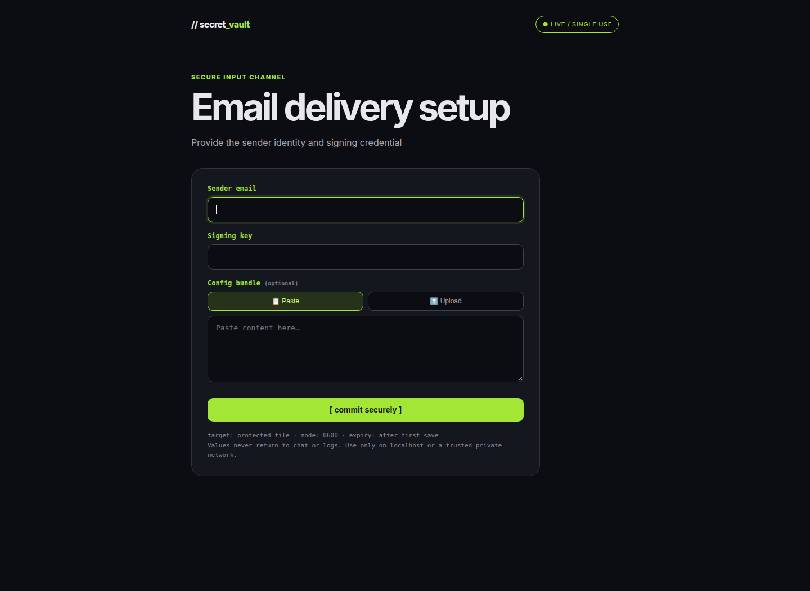
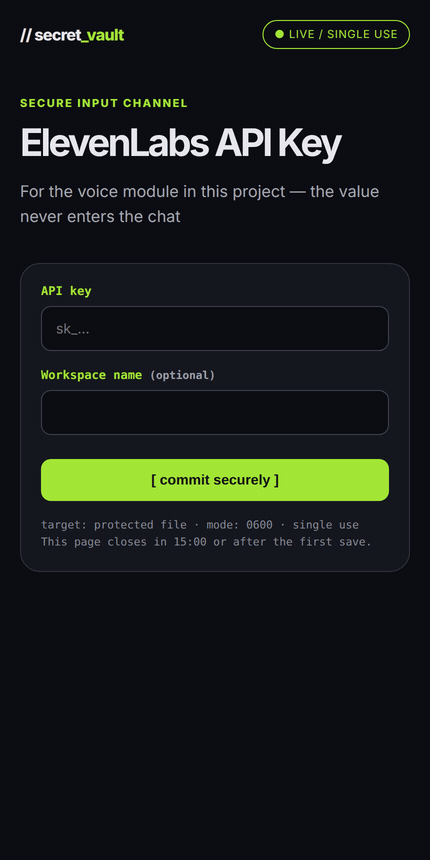
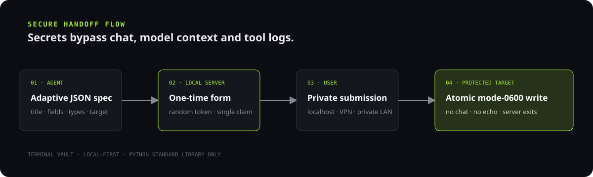

# 🔐 Terminal Vault — Confidential Input Form

**A one-shot, local-first form for handing secrets to AI agents without putting them in chat.**


[](https://github.com/kolijijani/confidential-input-form/actions/workflows/ci.yml)
[](https://github.com/kolijijani/confidential-input-form/releases/latest)


## 📖 Overview

AI agents often need an API key, password, certificate, email address, or config file to finish a task.
Pasting that value into chat puts it into model context, transcripts, and possibly tool logs.

Terminal Vault opens a task-specific form on your own machine. The agent decides which fields are needed;
the user submits directly to a protected local file. The server accepts one successful submission and
exits; if nobody submits before the deadline it closes itself and writes nothing.

The **Terminal Vault design stays fixed** while the form content adapts to each task.

## 📑 Table of contents

- [Features](#-features)
- [Preview](#-preview)
- [How it works](#️-how-it-works)
- [Requirements](#-requirements)
- [Installation](#-installation)
- [Usage](#-usage)
- [Configuration](#️-configuration)
- [Project structure](#-project-structure)
- [Development](#️-development)
- [Release](#-release)
- [Troubleshooting](#-troubleshooting)
- [Security](#-security)
- [Limitations](#️-limitations)
- [Changelog](#-changelog)

## ✨ Features

- Keeps secret values outside chat, model context, and application request logs.
- Lets an agent adapt the title, labels, field types, optional fields, and target file per task.
- Supports visible text, masked secrets, long text, code, file uploads, and paste-or-upload fields.
- Writes environment files or complete raw files such as JSON, YAML, PEM, and config files.
- Uses atomic mode-`0600` writes, symlink rejection, and random server-side upload names.
- Protects the form with a random URL token and a locked single-claim submission state.
- Closes itself after a deadline you set (`--expire-minutes`, 15 by default) and refuses wildcard binds.
- Preserves binary uploads with bounded, standards-aware multipart parsing.
- Runs on the Python standard library—no package installation required.
- Emits an optional value-free audit line per submission (`--audit-log`).
- Includes an agent-ready `SKILL.md`, an `install.sh`, practical examples, CI, and 33 tests (unit + real-socket end-to-end).

## 🖼️ Preview



*The running product: a task-specific email, signing-key, and paste-or-upload config form, with the
15-minute countdown in the footer. All values are dummy/empty.*

See it run — fill the form, it writes the file and closes itself:



Regenerate the capture with Chrome or Chromium:

```sh
python3 scripts/capture.py
```

## 🏗️ How it works



| Stage | Responsibility | Secret exposure |
|---|---|---|
| Agent | Creates a JSON form specification | Sees field definitions, never values |
| Local server | Serves a random-token, one-shot form | Holds values only while writing |
| User browser | Submits over localhost or a trusted private network | User controls the entry point |
| Protected target | Receives an atomic mode-`0600` write | Values remain local |

## 🧰 Requirements

- Linux or macOS with Python 3.10 or newer
- A modern browser
- Localhost, or a trusted private network when opening the form from another device
- Chrome/Chromium only if regenerating the README screenshot

No third-party Python packages are required.

## ⚡ Installation

```sh
git clone https://github.com/kolijijani/confidential-input-form.git
```

```sh
cd confidential-input-form
```

Run it straight from a checkout with no install step:

```sh
python3 scripts/secret_form.py --version
```

Install as a command with any Python tool manager (the script uses only the standard library):

```sh
pipx install git+https://github.com/kolijijani/confidential-input-form.git
```

```sh
uvx --from git+https://github.com/kolijijani/confidential-input-form confidential-input-form --version
```

Teach your agent the skill — the installer copies `SKILL.md` into the agent's skill directory and
rewrites the script path to this checkout:

```sh
./install.sh              # auto-detects ~/.hermes/skills, ~/.claude/skills, ~/.agents/skills
```

```sh
./install.sh ~/.claude/skills   # or name the directory explicitly
```

See [`docs/agents.md`](docs/agents.md) for the per-agent matrix (Hermes, Claude Code, Codex, Cursor).

## 🎯 Usage

Start the included API-key example:

```sh
python3 scripts/secret_form.py --spec examples/api-key.json
```

The command prints a one-time URL and waits for one successful submission:

```text
URL: http://127.0.0.1:8731/?t=<random-token>
TARGET: /home/user/.config/secret-vault/provider.env
EXPIRES: 900s
Waiting for one submission...
```

Open the URL on the same machine. After submission, the server writes the target and exits.
If nobody submits before the deadline, the server exits and writes nothing.

### 🧩 Adaptive form example

```json
{
  "title": "Email delivery setup",
  "subtitle": "Provide the sender identity and signing credential",
  "target": "~/.config/secret-vault/mail.env",
  "mode": "env",
  "fields": [
    {"key": "MAIL_FROM", "label": "Sender email", "type": "text"},
    {"key": "SIGNING_KEY", "label": "Signing key", "type": "password"},
    {"key": "MAIL_CONFIG", "label": "Config bundle", "type": "dual", "optional": true}
  ]
}
```

```sh
python3 scripts/secret_form.py --spec examples/email-and-key.json
```

### 📄 Raw file mode

Use `mode: "file"` when the submitted content is the target file itself:

```sh
python3 scripts/secret_form.py --spec examples/config-file.json
```

### ⏱️ Expiry and single use

The form is one-shot: the first successful save closes it. It also has a deadline, so an abandoned
link never stays open:

```sh
python3 scripts/secret_form.py --spec examples/api-key.json --expire-minutes 20
```

`--expire-minutes` defaults to 15; pass `0` to disable the deadline. When the deadline passes the
page returns `410 Gone` with an "This form expired" notice and no values are written. After the
process exits, the port is closed and the token is useless.

For OS-level belt-and-braces on a shared machine, wrap the process in a hard kill as well:

```sh
systemd-run --user --unit=secret-form --property=RuntimeMaxSec=900 --collect \
  python3 scripts/secret_form.py --bind 127.0.0.1 --spec examples/api-key.json
```

### 🧾 Audit log

`--audit-log PATH` appends one line per submission with the timestamp, outcome, field **names** and
byte count — never values:

```text
2026-10-22T04:31:07+00:00	saved-env	fields=MAIL_FROM,SIGNING_KEY	bytes=88
```

It is written `0600` and is useful when an agent needs to prove a handoff happened without touching
the secret.

## ⚙️ Configuration

### Field types

| Type | Intended use |
|---|---|
| `text` | Visible context such as email, account ID, region, or project name |
| `password` | Masked API keys, passwords, tokens, and signing secrets |
| `textarea` | Multi-line notes or short text blobs |
| `code` | Monospace JSON, YAML, PEM, config, or code |
| `file` | File upload |
| `dual` | Lets the user choose paste or upload |
| `optional: true` | Skips an empty field |

### Command options

| Option | Default | Purpose |
|---|---|---|
| `--spec` | — | JSON spec file, or `-` for stdin |
| `--target` | `~/.config/secret-vault/secrets.env` | Override the target file |
| `--bind` | `127.0.0.1` | IPv4 interface to listen on |
| `--port` | `8731` | Local TCP port |
| `--max-bytes` | `5242880` | Maximum request body size |
| `--files-dir` | target-adjacent `secret_files/` | Upload storage directory |
| `--expire-minutes` | `15` | Close the form after N minutes; `0` disables the deadline |
| `--allow-wildcard` | off | Permit `--bind 0.0.0.0` (denied by default) |
| `--audit-log` | none | Append a value-free line per submission |
| `--version` | — | Print the version and exit |

Wildcard binds are refused unless you pass `--allow-wildcard`, so a typo cannot quietly expose the
form on every interface. To open the form from another device, bind the machine's IPv4 address on a
trusted VPN or LAN:

```sh
python3 scripts/secret_form.py --bind 100.x.y.z --spec examples/api-key.json
```

## 📁 Project structure

```text
.
├── .github/workflows/ci.yml       # Multi-version Python CI
├── docs/
│   ├── architecture.svg           # Secure handoff flow
│   ├── social-preview.png         # 1280x640 card for GitHub link previews
│   └── screenshots/               # Real product captures
├── docs/agents.md                 # Per-agent skill install matrix
├── examples/                      # Ready-to-run JSON specs
├── install.sh                     # Copy SKILL.md into an agent skill dir
├── pyproject.toml                 # Console script (pipx / uvx installable)
├── scripts/
│   ├── capture.py                 # Reproducible screenshot capture
│   └── secret_form.py             # One-shot server and renderer
├── tests/
│   ├── test_secret_form.py        # Unit tests: rendering, writes, parsing
│   └── test_e2e.py                # Real-socket tests: save, expiry, audit
├── CHANGELOG.md
├── LICENSE
├── README.md
├── SECURITY.md
└── SKILL.md                       # AI-agent operating instructions
```

## 🛠️ Development

Compile and run the full suite:

```sh
python3 -m py_compile scripts/secret_form.py tests/test_secret_form.py
```

```sh
python3 -m unittest discover -v
```

The suite covers atomic permissions, symlink handling, env injection, binary multipart integrity,
malformed requests, randomized uploads, IPv6 rejection, and concurrent token claims.

## 📦 Release

A release is ready when:

1. All tests pass across supported Python versions.
2. The security scan finds no real secrets or machine-specific data.
3. The current screenshot is regenerated and visually reviewed.
4. `CHANGELOG.md` is updated.
5. The version tag and GitHub release are published from the same commit.

## 🩺 Troubleshooting

### The URL works only on the server machine

The secure default is `127.0.0.1`. Bind explicitly to a trusted private IPv4 address when another
device must open the form. Never bind to a public interface without a protected tunnel and TLS proxy.

### Port already in use

Choose another unprivileged port:

```sh
python3 scripts/secret_form.py --port 8732 --spec examples/api-key.json
```

### The page closes after submission

That is expected. A successful submission consumes the token and shuts the server down. Start a new
process to collect another value.

### A target symlink is rejected

That is deliberate protection against redirecting a secret into an unexpected file. Use a regular file
path owned by the current user.

## 🔐 Security

Terminal Vault is a **local handoff utility**, not an internet-facing secret manager.

- Use localhost or a trusted private network such as Tailscale/VPN.
- Treat the random URL as confidential until it is consumed.
- The built-in server uses HTTP; place a trusted TLS proxy in front when transport encryption is required.
- Never expose the server directly to the public internet.
- Secret values are never printed by the application and HTTP request logging is disabled.
- Targets and uploads are created with mode `0600`; symlink targets are rejected.
- One concurrent request claims the token; later requests are rejected.

Read [SECURITY.md](SECURITY.md) for the complete threat model and reporting process.

## 🗺️ Limitations

- HTTP is built in; HTTPS termination belongs to a trusted local proxy or private overlay network.
- IPv6 bind addresses are not supported.
- Windows is not supported: its filesystem permission and symlink semantics do not provide the POSIX guarantees this release enforces.
- The process is intentionally single-use and stores no submission history; the deadline and single-use claim only shrink the window in which a leaked link is useful, they do not protect a credential after it lands.
- This tool does not rotate, revoke, or validate the submitted credential.
- Protect the destination directory and host as part of your normal security posture.

## 📝 Changelog

See [CHANGELOG.md](CHANGELOG.md). The first public release is `v1.0.0`.

## 🤝 Ownership and contact

Maintained by [Mohammad Koliji Jani Bin Azizan](https://github.com/kolijijani).

For security issues, use a private GitHub security advisory and never include a real credential.

---

Maintained by Mohammad Koliji Jani Bin Azizan · Last updated 2026-10-21
